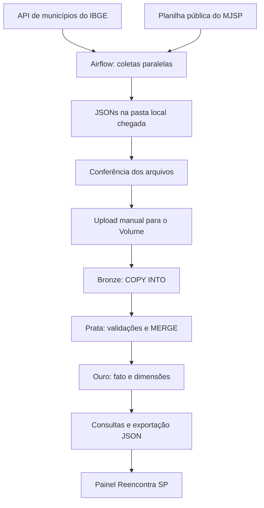

# Reencontra-sp-bigdata
Reencontra SP — Global Solution FIAP: pipeline de dados com Airflow e Databricks.

## Arquitetura do pipeline

O Airflow coleta dados de duas fontes oficiais: a API de municípios de São Paulo do IBGE e a planilha estatística de desaparecimentos e localizações do MJSP.

As coletas são independentes e permitem execução em paralelo. A tarefa `conferir_arquivos` verifica a existência e o conteúdo dos JSONs gerados.



### Responsabilidade de cada camada

| Componente | Responsabilidade |
|---|---|
| Airflow | Coletar as fontes, salvar arquivos datados e conferir sua chegada. |
| Volume | Armazenar os JSONs enviados manualmente ao Databricks. |
| Bronze | Preservar os campos dos JSONs e ingerir somente arquivos ainda não processados. |
| Prata | Converter tipos, validar registros, separar rejeitados e consolidar os aprovados pela chave de negócio. |
| Ouro | Organizar os indicadores em uma tabela fato e dimensões de estado, mês e perfil. |
| MVP | Apresentar os resultados da Ouro por meio de uma exportação JSON. |

A planilha do MJSP é transformada pela DAG antes de chegar à Bronze. As estatísticas são estaduais; não são distribuídas entre os municípios.

O upload para o Volume e a atualização do painel são manuais. Não há sincronização automática entre Airflow, Databricks e o site.

## Passo a passo para reproduzir

### 1. Pré-requisitos

- Ubuntu ou outro ambiente compatível com Airflow.
- Python e ambiente Airflow 3 operacional.
- Bibliotecas `requests`, `pendulum` e `openpyxl` disponíveis no ambiente do Airflow.
- Databricks com permissão para criar schema, Volume e tabelas.
- Acesso à internet para consultar as fontes oficiais.

### 2. Preparar a DAG

1. Baixar ou clonar este repositório.
2. Copiar `dags/reencontra_coleta.py` para a pasta de DAGs configurada no Airflow.
3. Ajustar `PASTA_CHEGADA` no arquivo, caso o ambiente utilize outro caminho.
4. Garantir permissão de escrita nessa pasta.
5. Verificar se a DAG `reencontra_coleta` aparece na interface.

No ambiente original do projeto, os caminhos são:

- Ambiente virtual: `/root/reencontra/.venv`
- Diretório do Airflow: `/root/reencontra/airflow`
- Pasta de DAGs: `/root/reencontra/dags`
- Arquivos coletados: `/root/reencontra/chegada`

Para iniciar esse ambiente já instalado:

```bash
source /root/reencontra/.venv/bin/activate
export AIRFLOW_HOME=/root/reencontra/airflow
export AIRFLOW__CORE__DAGS_FOLDER=/root/reencontra/dags
export AIRFLOW__CORE__LOAD_EXAMPLES=False
airflow standalone
```

Esses comandos utilizam os caminhos da instalação original. Em outra máquina, é necessário preparar o ambiente e adaptar os caminhos.

### 3. Executar as coletas

1. Acessar a interface local do Airflow.
2. Ativar a DAG `reencontra_coleta`.
3. Acionar uma execução.
4. Aguardar o sucesso de:
   - `coletar_municipios`;
   - `coletar_desaparecimentos`;
   - `conferir_arquivos`.
5. Conferir os arquivos e as contagens nos logs.
6. Realizar outra coleta em um dia diferente.

A DAG está agendada diariamente às 8h, no fuso de São Paulo. O serviço precisa permanecer ativo para executar o agendamento.

As fontes utilizadas não exigem chave de API.

### 4. Preparar o Databricks

1. Importar os notebooks da pasta `databricks`.
2. Abrir `01_pipeline_reencontra_sp`.
3. Executar a célula inicial que cria o schema, o Volume e as pastas.

Os destinos utilizados são:

```text
/Volumes/workspace/reencontra/chegada/municipios_ibge
/Volumes/workspace/reencontra/chegada/desaparecimentos_sp
```

Caso o catálogo `workspace` não exista no ambiente de reprodução, adaptar os nomes e caminhos nos notebooks.

### 5. Enviar e ingerir o primeiro lote

1. Enviar manualmente ao Volume os JSONs da primeira coleta, cada um na pasta de sua fonte.
2. Manter os nomes originais.
3. Executar as células de ingestão Bronze do notebook 01.
4. Registrar as contagens antes e depois da carga.

A ingestão utiliza `COPY INTO`.

### 6. Demonstrar incrementalidade

1. Enviar os arquivos da coleta realizada em outro dia.
2. Executar novamente as células de ingestão Bronze.
3. Registrar quantas linhas foram acrescentadas.
4. Reexecutar a ingestão sem adicionar arquivos.
5. Confirmar que a contagem permanece igual e que nenhuma nova linha é inserida.

Arquivos novos podem conter as mesmas combinações de negócio de lotes anteriores. A Bronze preserva os lotes; a consolidação ocorre na Prata.

### 7. Construir a Prata

Executar as células de tratamento do notebook 01, na ordem.

São aplicadas quatro regras:

1. UF igual a SP.
2. Ano e mês válidos.
3. Indicador, faixa etária e sexo permitidos.
4. Quantidade inteira, não negativa e não ausente.

Os registros inválidos são preservados na tabela de rejeitados. Valores ausentes não são substituídos automaticamente por zero.

As repetições idênticas dos aprovados são removidas e o `MERGE` utiliza a chave:

```text
UF + ano + mês + indicador + faixa etária + sexo
```

Se houver versões conflitantes da mesma chave, a execução é interrompida para revisão.

### 8. Construir a Ouro

Executar as células de criação e verificação da Ouro no notebook 01.

Tabelas principais:

- `ouro_fato_desaparecimentos`
- `ouro_dim_uf`
- `ouro_dim_mes_desaparecimentos`
- `ouro_dim_perfil_desaparecimentos`

Executar a verificação dos relacionamentos para conferir se os joins preservam a quantidade de linhas da fato.

### 9. Executar consultas e testes

No notebook `02_consultas_reencontra_sp`, executar as consultas sobre:

1. Totais anuais e preenchimento.
2. Distribuição mensal.
3. Distribuição por faixa etária.
4. Distribuição por sexo.
5. Variação entre 2023 e 2024.

As células complementares de usabilidade reproduzem os três resultados de testes manuais relatados pela equipe. Sua execução não realiza novos testes com usuários.

No notebook `03_testes_qualidade_sp`, executar os sete casos artificiais de validação. O resultado esperado é um aprovado e seis rejeitados. Esses casos utilizam views temporárias e não alimentam as camadas reais.

Se disponível no repositório, o notebook `00_fontes_reencontra_sp` pode ser executado após o upload para conferir fontes, arquivos e amostras, sem modificar as tabelas.

### 10. Gerar os dados para o MVP

No notebook 02, executar a célula de exportação da Ouro.

O arquivo será salvo em:

```text
/Volumes/workspace/reencontra/chegada/saida_mvp/indicadores_sp.json
```

Baixar o arquivo e utilizá-lo na atualização do painel.

Gerar um novo JSON não atualiza automaticamente o site. A substituição dos dados e a publicação do painel são etapas separadas.

[Painel público Reencontra SP](https://reencontra-sp-irana-dados.amusinghedge.chatgpt.site)

### Resultados de referência

Na versão analisada:

| Verificação | Resultado |
|---|---:|
| Municípios distintos de SP | 645 |
| Combinações do MJSP por arquivo | 1.080 |
| Combinações válidas consolidadas na Prata | 1.079 |
| Fato de desaparecimentos | 1.079 |
| Dimensão estado | 1 |
| Dimensão mês | 36 |
| Dimensão perfil | 15 |

As contagens da Bronze dependem da quantidade de arquivos enviados. Revisões das fontes podem alterar os resultados.

### Limitações de interpretação

- Os dados representam registros agregados, não pessoas únicas.
- Localizações podem se referir a desaparecimentos de anos anteriores.
- A diferença entre desaparecimentos e localizações não representa casos em aberto.
- Localizações de 2025 apresentam um campo ausente na versão analisada.
- A avaliação com três participantes é um indicador inicial de usabilidade, sem comprovar redução de desaparecimentos.
